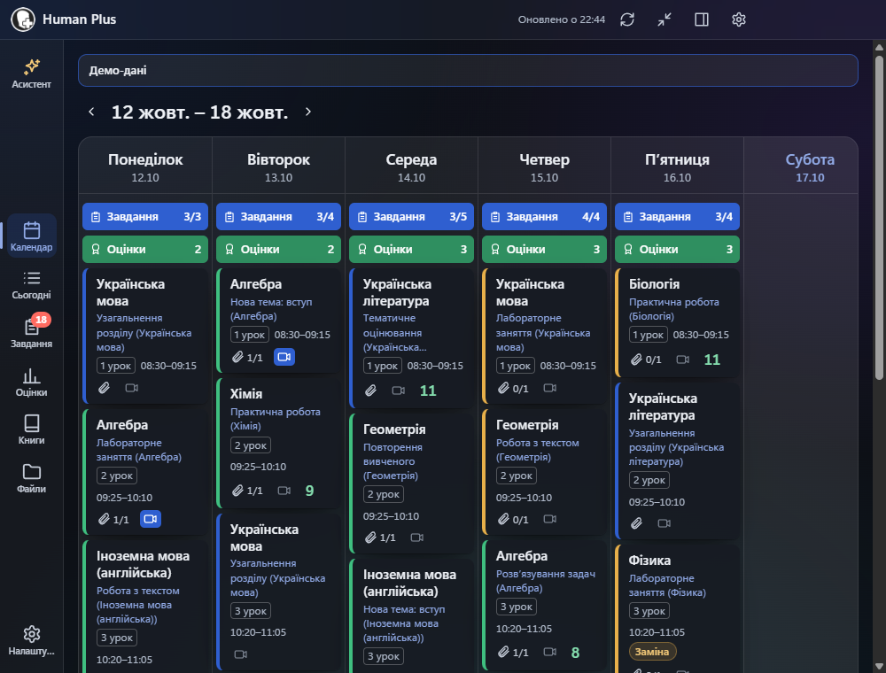
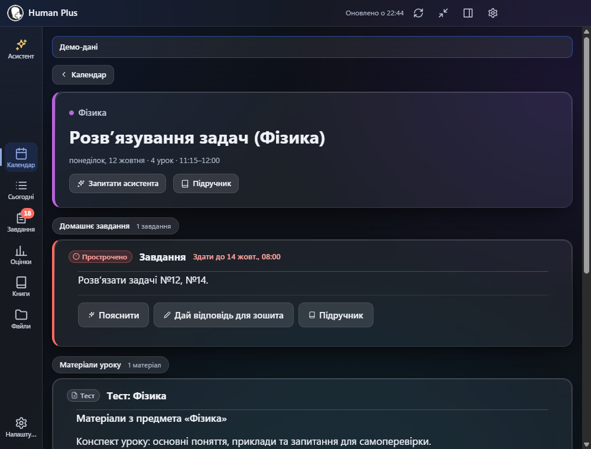
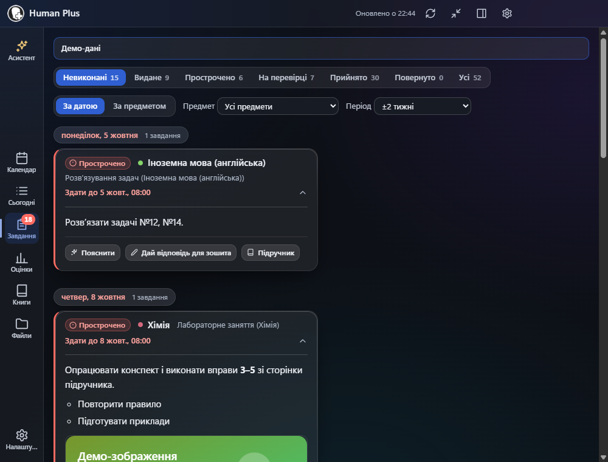
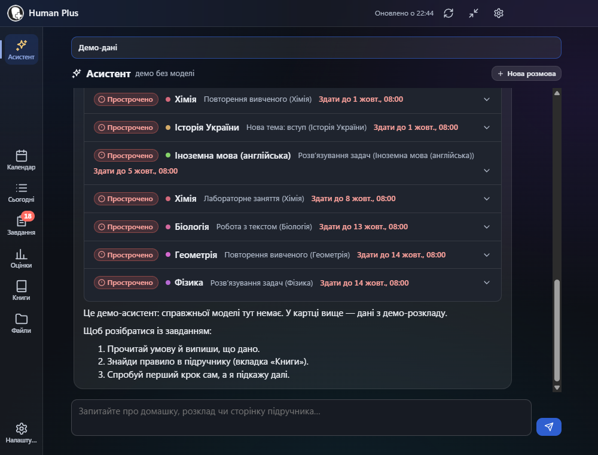
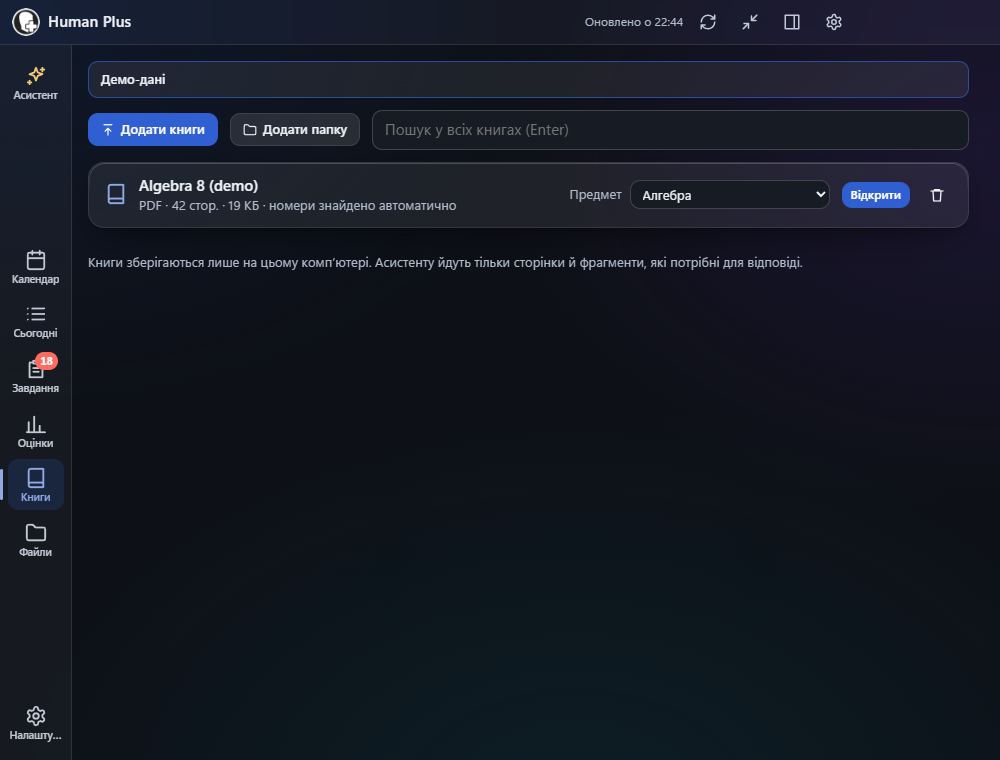
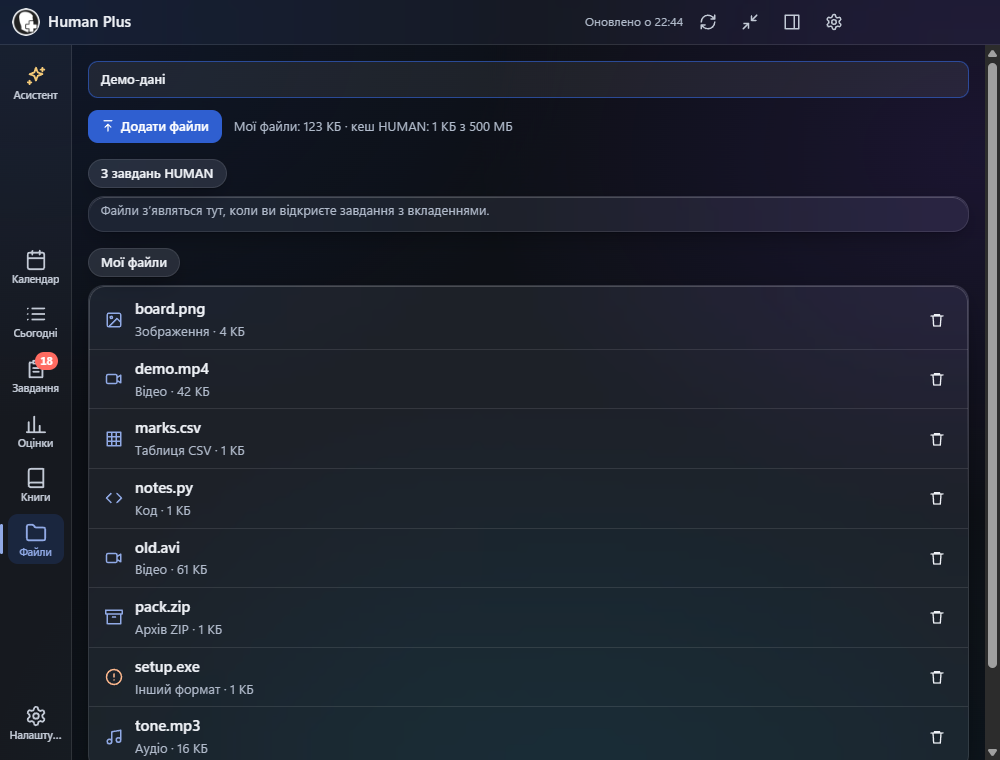
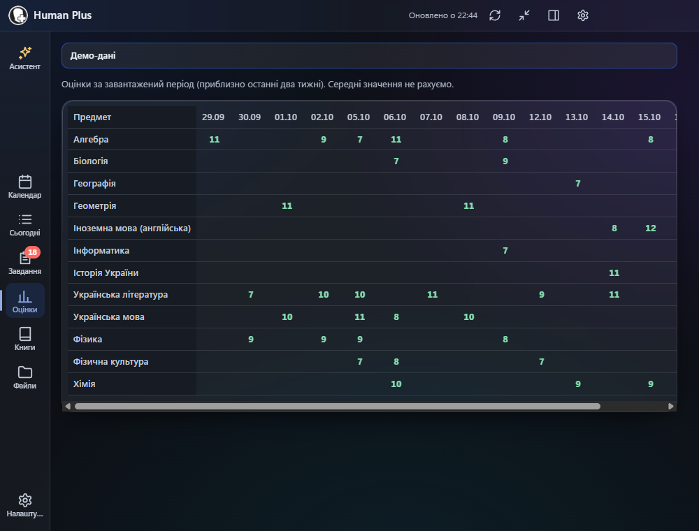
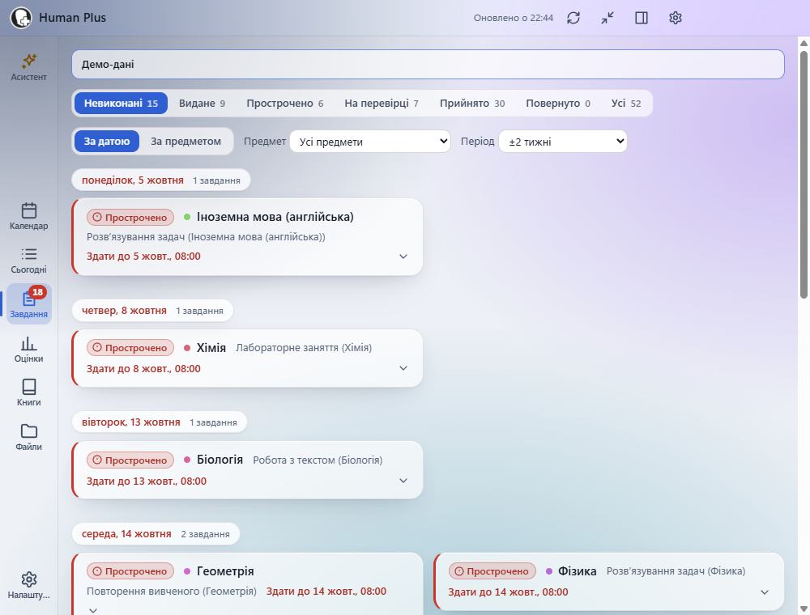
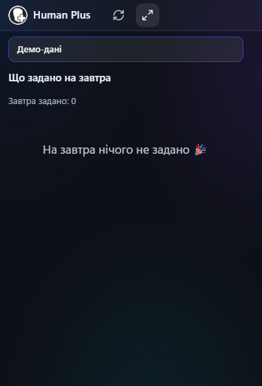

# Human Plus

**Застосунок для учнів HUMAN Школа з вбудованим ШІ-асистентом.** Розклад, домашні завдання, оцінки, підручники й файли на одному екрані,
а поруч асистент, який бачить ваші дані й допомагає з уроками. До HUMAN лише читання: без здач завдань, без чужих даних, без телеметрії.



## Що вміє

- **Календар:** тиждень на 7 днів. Над кожним днем смужки «Завдання здано/усього» й «Оцінки». На картці уроку: предмет, тема, номер уроку й час, матеріали, Zoom і оцінка.
  **Клік по уроку** відкриває сторінку уроку: тема, «Приєднатися до уроку», домашнє завдання й матеріали з повним змістом.
- **Сьогодні:** таймлайн уроків дня з відліком до наступного й блок «На завтра».
- **Завдання:** картки зі статусом і дедлайном, категорії «Невиконані / Видане / Прострочено / На перевірці / Прийнято / Повернуто», фільтр за предметом і періодом.
- **Оцінки:** таблиця «предмет × дата».
- **Асистент** (чат на окремій вкладці або поруч із контентом, відповіді стримляться):
  - сам дивиться розклад, домашку й оцінки (інструменти лише читають дані застосунку);
  - у кожному завданні є кнопки **«Пояснити»** і **«Дай відповідь для зошита»**;
  - знаходить сторінку підручника за посиланням із домашки («с. 34, № 2»).
- **Книги:** завантажте PDF, EPUB, DOCX чи TXT або цілу папку й призначте кожній книзі предмет.
  - Номери сторінок PDF калібруються автоматично (мітки PDF або номери на полях сторінок, з урахуванням вклейок); калібрувати можна й вручну.
  - Вбудований читач: виділіть фрагменти й натисніть **«Показати асистенту»**, і він отримає лише їх.
  - Скани без тексту асистент отримує зображенням сторінки.
- **Файли:** вкладення з завдань і власні файли відкриваються у вбудованому переглядачі:
  - зображення з масштабом;
  - відео й аудіо (потокове відтворення; якщо формат не підтримується — «Відкрити зовні»);
  - PDF, DOCX, XLSX/CSV, PPTX, текст і код із підсвіткою, список вмісту ZIP.
  - Програми, HTML, SVG та невідомі формати не відкриваються: їх можна лише зберегти з попередженням.
- Міні-режим «Що задано на завтра» (Ctrl+Shift+H), лічильник у треї, сповіщення про завтрашні дедлайни, світла й темна теми, офлайн-кеш.

| Сторінка уроку | Завдання |
|---|---|
|  |  |

| Асистент | Книги | Файли |
|---|---|---|
|  |  |  |

| Оцінки | Світла тема | Міні-режим |
|---|---|---|
|  |  |  |

Усі скриншоти зроблено на **демо-даних** (`npm run demo`), персональних даних учня в матеріалах немає.

## Асистент: як підключити

1. **Налаштування → Асистент:** оберіть сервіс ШІ.
   - **Claude (Anthropic)**, типово, модель `claude-sonnet-5-5`;
   - **OpenAI-сумісний** (адресу сервісу вказуєте самі, лише https);
   - **Gemini (Google)**.
2. Вставте свій ключ API. Ключ зберігається лише зашифрованим (Windows DPAPI) і не показується у вікні, видно тільки маску.
3. Перед першим запитом застосунок покаже, що саме буде відправлено, і попросить згоди.

Вхід через підписку claude.ai як «бекенд» не підтримується: потрібен ключ API.

## Чого застосунок **не** робить

- Не здає завдань, не змінює статусів, не пише повідомлень: до HUMAN іде лише `GET`.
- Не читає й не зберігає пароль чи токени HUMAN: ви входите самі на справжній сторінці HUMAN усередині вікна.
- Не бачить чужих даних: лише акаунт учня, що увійшов. Для інших ролей показується «Додаток доступний лише для учнів»,
  а перед **кожним** запитом до ШІ роль «учень» перевіряється заново (якщо перевірка не вдалась, запит не відправляється).
- Не відправляє в ШІ цілі книги, ваші файли, пароль чи токени, лише потрібне для відповіді (див. [PRIVACY.md](PRIVACY.md)).
- Не збирає телеметрію.

## Як це працює

```
вікно (src/app.js, ванільний JS, без мережі)  ←IPC→  main.js ─┬→ session persist:human → api.human.ua / files.human.ua (лише GET)
                                                             ├→ src/ai/ (контекст, інструменти, провайдери) → сервіс ШІ з вашим ключем
                                                             ├→ src/books/ (бібліотека, пошук сторінки, калібрування)
                                                             └→ src/files/ (сховище, протокол hp-file з Range, офісні формати)
```

- Усе, що знає про формат HUMAN, — у `src/api.js`, `src/blocks.js`, `src/normalize.js`.
- Усе, що йде в модель, формується в одному місці: `src/ai/context.js`.
- Вікно працює із суворим CSP (`connect-src 'none'`); мережею користується лише main-процес, і лише в межах `src/allowlist.js`.

## Приватність

Кеш, книги й файли лежать лише локально, паролі й токени HUMAN не зберігаються, ключі API зашифровані. Докладніше — [PRIVACY.md](PRIVACY.md).

## Встановлення

**[⬇ Завантажити для Windows (остання версія)](https://github.com/PREDATTORRGGDR/Human-Plus/releases/latest)**

- `Human Plus-Setup-1.2.0.exe`: інсталятор (для поточного користувача, без прав адміністратора). Запуск нового інсталятора оновлює встановлену версію на місці, дані зберігаються;
- `Human Plus-portable-1.2.0.exe`: портативна версія без встановлення.

Контрольні суми SHA-256 — в описі релізу.

### Попередження Windows SmartScreen

Застосунок **не підписаний сертифікатом розробника**, тому Windows покаже синє вікно «Windows захистила ваш ПК».
Щоб запустити: **«Докладніше»** → **«Виконати в будь-якому разі»**. Перевірити файл можна за SHA-256 з опису релізу.

### З вихідного коду

Потрібен Node.js 22+.

```bash
npm ci
npm start          # справжній режим
npm run demo       # демо без акаунта (асистент відповідає за сценарієм, без ключа)
npm test           # тести
npm run dist       # інсталятор NSIS і portable у папці dist/
```

## Обмеження

- API HUMAN недокументоване й може змінитися: тоді частина секцій деградує, а після виправлення в `src/api.js` усе повернеться.
- Не перевірено на акаунті вчителя: відмова спирається на перелічення ролей і юніт-тести `isStudent`.
- Асистент перевірено на тестах із підробленими відповідями сервісів; якість відповідей залежить від обраної моделі.
- OCR немає: скани сторінок асистент отримує зображенням. Відео в форматах, яких не підтримує Chromium (наприклад AVI), відкриваються зовнішнім програвачем.
- Збірка не підписана (SmartScreen), автооновлення немає.

## Ліцензія

Усі права захищені. Застосунок можна безкоштовно встановлювати й використовувати для особистих некомерційних цілей; копіювати, змінювати чи поширювати код і збірки без письмової згоди власника не можна.
Перегляд коду в репозиторії лише для ознайомлення. Повний текст: [LICENSE](LICENSE).
